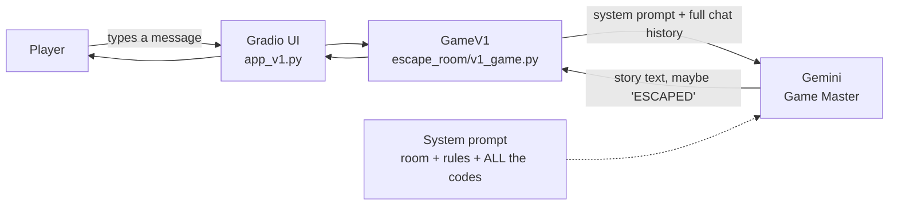

# Architecture - Version 1

## The parts

| Part | What it does |
|---|---|
| `app_v1.py` | The Gradio page: chat window, text box, Send and Restart buttons. |
| `escape_room/v1_game.py` | Keeps a list of all messages and sends the whole list to Gemini every turn. Checks the reply for the word `ESCAPED` to know the game is over. |
| `escape_room/llm.py` | Talks to the Gemini API, retries if the model is busy. |
| System prompt | Describes the room, the order of the puzzles and the codes. |

## How one turn works

1. The player types something like "examine the bookshelf".
2. The message is added to the history.
3. The whole history plus the system prompt goes to Gemini.
4. Gemini writes the answer. It decides on its own if the action worked.
5. The answer is shown and added to the history.

## Why this is fragile

- There is no real game state. "Is the drawer open?" only exists as text in old messages.
- The model decides if something works, so a convincing message can change the outcome.
- The codes are inside the prompt, so the model *knows* them every single turn and can say them by mistake or when asked cleverly.
- The history grows every turn, so long games get slower and the model can lose track.
